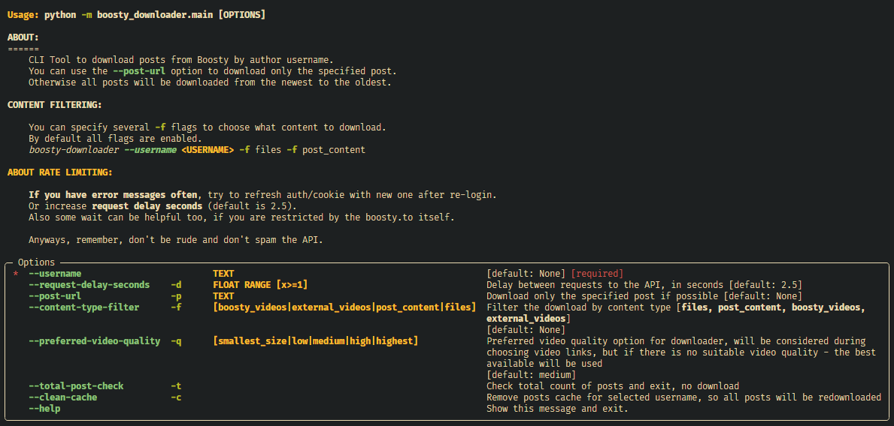
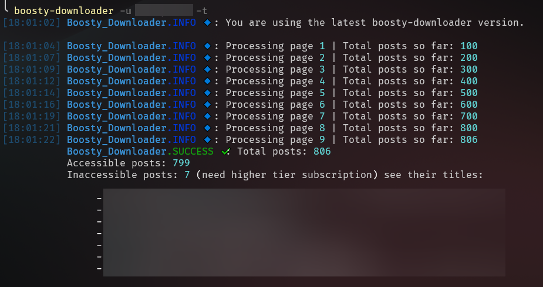
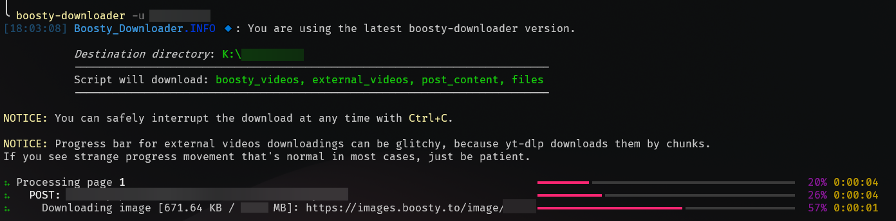
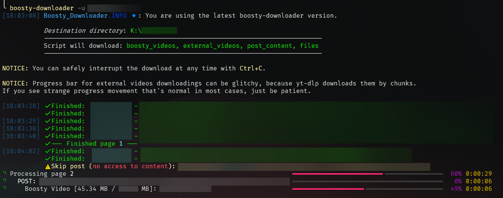
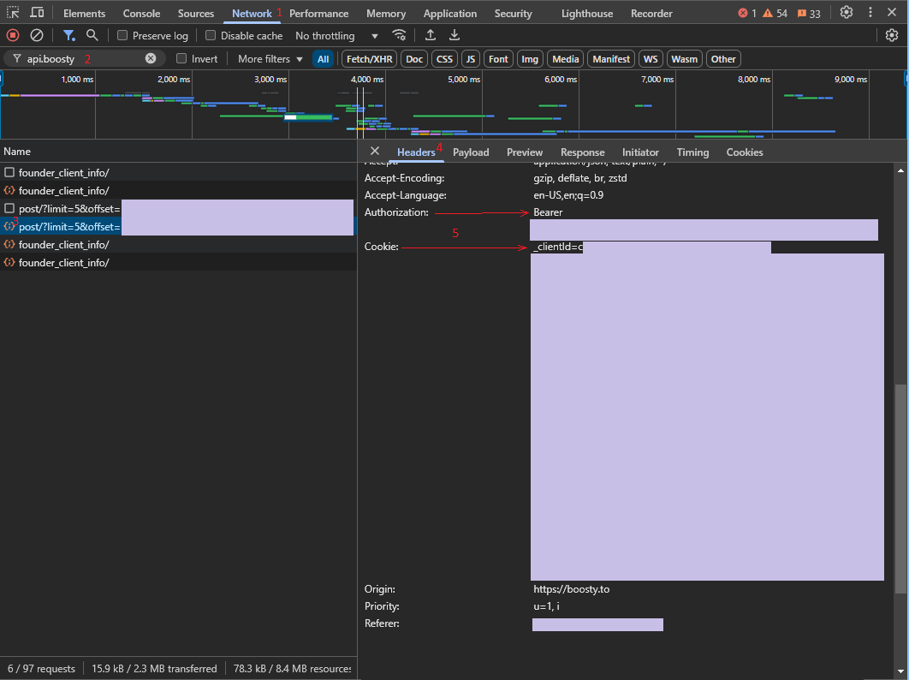
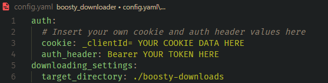

<p align="center">
    
</p>

# 🖥️ About

Welcome to the **Boosty Downloader** project! 

This CLI tool downloads content from Boosty.to in bulk and saves complete post pages as styled HTML. Each post also has a `post.json` record that keeps its content and individual media states across runs.

**You can download:**

- Boosty Videos
- External Videos (YouTube, Vimeo)
- Files
- Audio
- Full Post content (including photos and links)

## 📑 Table of Contents
- [🖥️ About](#️-about)
  - [📑 Table of Contents](#-table-of-contents)
  - [✨ Features](#-features)
  - [📸 Screenshots \& Usage](#-screenshots--usage)
  - [🛠️ Installation](#️-installation)
  - [🚀 Configuration for Usage](#-configuration-for-usage)
    - [Step 1: Get the auth cookie and auth header](#step-1-get-the-auth-cookie-and-auth-header)
      - [Option 1 - Manually](#option-1---manually)
      - [Option 2 - With helper script](#option-2---with-helper-script)
    - [Step 2: Paste the cookie and auth header into the config file](#step-2-paste-the-cookie-and-auth-header-into-the-config-file)
    - [Step 3: Run the utility](#step-3-run-the-utility)
  - [🔄 Continuing a download](#-continuing-a-download)
  - [🛡️ When downloads fail](#️-when-downloads-fail)
  - [💖 Contributing](#-contributing)
  - [📜 License](#-license)


## ✨ Features

- 📦 **Bulk download**: Download all available content from your favorite creator.
- 🔎 **Blog overview**: `check` shows what each subscription tier gives (posts and share of the blog), where you stand, what the rest costs, media counts and the posting date range.
- 🧪 **Dry run**: `download --dry-run` reads the same saved records and local files as a real run. It reports new, changed and unchanged posts, selected media to fetch and known bytes, with unknown video sizes shown separately. It creates or changes no files.
- 📈 **Run statistics**: every download ends with what it did: posts, media by type, total size and time.
- 📂 **Content type filters**: Choose which media to fetch with `--content-type-filter`; the page still describes the full post and shows the state of media not downloaded yet.
- 📄 **Download specific posts**: Download post by url and username.
- 🔃 **Continue across runs**: Finished media is remembered individually. A later run can add other content types and refresh the page while keeping files downloaded earlier.
- 📼 **Choose your video quality**: You can choose preferred video quality to download (for boosty videos)
- 🎨 **Beauty posts preview**: You can see posts content with rendered offline html files with dark/light theme changing.
- 📊 **Order matters**: Posts have dates in names, so you can just sort it by name in your file explorer and see them in the correct chronological order.
- 🆙 **App update checker**: If new updates are available, you'll be notified when you use the application next time.
- 🔑 **Auth helper script**: Run `boosty-downloader show-auth-script` to get a browser console script that extracts your credentials automatically.


## 📸 Screenshots & Usage







## 🛠️ Installation

1. **Install python**:
   - Window:
      ```bash
      winget install Python.Python.3.13
      ```
   - Linux:
      ```bash
      sudo apt-get install python3
      ```
   - macOS:
      ```bash
      brew install python
      ```

2. **Install the boosty-downloader package:**
   ```bash
   pip install boosty-downloader
   ```

3. **Run the application:**
   ```bash
   boosty-downloader --help
   ```

## 🚀 Configuration for Usage

### Step 1: Get the auth cookie and auth header

#### Option 1 - Manually

1. Open the [Boosty](https://boosty.to) website.
2. Click the "Sign in" button and fill you credentials.
3. Navigate to any author you have access to and scroll post a little.
4. Copy auth token and cookie from browser network tab.



#### Option 2 - With helper script

1. Run `boosty-downloader show-auth-script` to show the helper script (it will be copied to your clipboard automatically).
2. Open the [Boosty](https://boosty.to) website and log in.
3. Open browser console (F12) and paste the script.
4. Scroll the page a little - a floating box with your credentials will appear.

### Step 2: Paste the cookie and auth header into the config file

A first `download` or `check` run creates a sample `config.yaml` in the current working directory if it is missing. Use `--config PATH` before the command name to choose another file. `download --dry-run` requires an existing config and reports an error without creating a sample.



### Step 3: Run the utility

Now you can just download your content with the following command:

```bash
boosty-downloader download YOUR_CREATOR_NAME
```

## 🔄 Continuing a download

Use the same destination for successive runs. For example, save text and images first, inspect the remaining work, then add the other media:

```bash
boosty-downloader download YOUR_CREATOR_NAME -f post_content -o ./v5-downloads
boosty-downloader download YOUR_CREATOR_NAME --dry-run -o ./v5-downloads
boosty-downloader download YOUR_CREATOR_NAME -o ./v5-downloads
```

The preview covers the whole blog; `--dry-run` cannot be combined with `--post-url`. `post_content` includes the post's images. Each saved page includes the complete body, downloaded media from earlier runs and placeholders for media that has not been downloaded. The final command adds the remaining selected media to the same pages.

Records and pages live under `<destination>/<creator>/<post folder>/`. Renaming a post on Boosty does not move its saved folder. Content files you delete locally are recorded as deleted and stay deleted on an ordinary run. The summary counts remaining deleted media in the accessible, non-excluded posts processed by this run. Media removed by the author stays in the saved history, including any local copy.

To restore deleted files that are still in the creator's posts, preview and run with `--restore-missing`:

```bash
boosty-downloader download YOUR_CREATOR_NAME --restore-missing --dry-run -o ./v5-downloads
boosty-downloader download YOUR_CREATOR_NAME --restore-missing -o ./v5-downloads
```

Content filters also apply to restoration, and the option works with `--post-url`. Files removed from the post by the creator are never restored. A file you edited or re-encoded is kept at its current size. A file you copy back is recognized without another download. Deleting a whole post folder makes it a new download even without this option.

Each real download refreshes the creator's title, description, display name, avatar and cover. Author details and images live in `<destination>/<creator>/.boosty-downloader/`; `author.json` refers to those images with paths relative to the creator's folder. If metadata or an image cannot be fetched, a warning is shown and the saved version remains available.

Posts observed without access are listed in `.boosty-downloader/locked.json` without creating a post folder. Losing access keeps any previously saved page, media and viewing marks. Confirmed access clears the corresponding locked observation even if a tag excludes that post from downloading. The file records observed access, so posts not encountered during a partial run are retained. `--dry-run` and `check` do not update these records or images.

Video previews are saved under each post's `previews/` directory, even when video downloads are filtered out or the video is not ready yet. Locked-post teasers live in the creator's `.boosty-downloader/teasers/` directory. Existing usable previews and teasers are reused; missing ones are fetched on a later run without `--restore-missing`. Excluded tags prevent these image downloads too. Their transfers do not count as downloaded post media.

Library cover selection uses the first current downloaded image, then the preview of the first current Boosty video. A locked post uses its teaser. Removed media cannot become the cover. These images and cover rules prepare the saved records for the library viewer; they do not add a new viewer command yet.

This development version uses `post.json` instead of the v4 SQLite cache. Choose a fresh destination for v5. The first actual download marks it with `.boosty-downloader/library.json`; dry-run never creates the marker. If an unmarked destination contains post folders from any creator, `download` in every mode, `render` and `reindex` stop before network requests, sample configuration or log writes. Keep the old destination while it contains posts that Boosty no longer serves. Existing downloads are not migrated or adopted automatically.

Downloads also update a disposable search index at `<destination>/.boosty-downloader/index.db`. `--cache-dir PATH` places it at `PATH/index.db`, which is useful when downloads live on a network share. Canonical records and media stay in the destination. If indexing fails, the run warns once and continues saving downloads; run `reindex` after fixing the cache location to rebuild it from the records. The legacy `clean-cache` command has been removed; saved records and media are never reset by index maintenance.

Rebuild the search index for the entire saved library without contacting Boosty:

```bash
boosty-downloader reindex -o ./v5-downloads
boosty-downloader reindex -o ./v5-downloads --cache-dir ~/.cache/boosty-v5
```

The command reports the author and post counts and the index location. It uses the destination and cache paths from YAML unless overridden on the command line; credentials are not required. Saved records, viewing marks, HTML pages and media remain unchanged. It does not migrate older downloads.

Rebuild saved HTML pages without contacting Boosty:

```bash
boosty-downloader render -o ./v5-downloads
boosty-downloader render YOUR_CREATOR_NAME -o ./v5-downloads
```

Omit the creator to render the whole library. The command needs no credentials or search index. It uses the complete saved body and the files currently on disk, including retained media removed by the creator. Local media observations and the successful page-template version are saved in `post.json`; API synchronization timestamps, media files and viewing marks are preserved. Posts with no saved body have no page to rebuild. A previously saved body remains usable after losing access to the remote post.

## 🛡️ When downloads fail

- Connection errors, HTTP 5xx and rate limits get transport retries with growing pauses. The post has up to 5 attempts; an expired media link can trigger one API refresh.
- Each finished media piece is saved to the record immediately. A failed attachment does not make another completed attachment or video download again.
- At the end of the post's attempts, `post.html` is built from the complete saved record. Failed, unavailable and not-yet-downloaded media retain their places with a status message. A later successful run updates those places.
- A selected external video that is deleted, private or blocked is checked once per run. It does not prevent retries for another piece with a temporary failure, and an unavailable video alone does not count toward the failure streak.
- Media downloads use private temporary output and take their final names only when complete. A later run can recover a completed file published before its record update; an interrupted transfer is not accepted as a finished file. Existing unrelated files are not overwritten.
- Cancellation preserves finished pieces. A forced interruption may leave the previous HTML page until the next run rebuilds it.
- A page-rendering failure does not discard downloaded media. The post remains unsuccessful so that another run can rebuild the page.
- Download failures are recorded in `failed_downloads.log` inside the creator's folder, and the run ends with a summary.
- After 5 failed posts in a row, the downloader stops. Add `--skip-all-failures` to continue despite a failure streak.
- `download --post-url` uses the same retry and recovery behavior for one post.

After fixing the cause, run the same command again. The downloader reads the records and local files and fetches only the selected pieces still eligible for download.

For diagnostics, use `--debug` before the command name. Ordinary runs write `boosty-downloader-debug.log` with request details and error tracebacks; signed download keys are removed from request URLs. With `download --dry-run`, diagnostics go to the console, and an existing debug log is left unchanged. Include the relevant diagnostics in a [GitHub issue](https://github.com/Glitchy-Sheep/boosty-downloader/issues).

## 💖 Contributing

If you want to contribute to this project, please see the [CONTRIBUTING.md](CONTRIBUTING.md).

## 📜 License

This project is licensed under the MIT License - see the [LICENSE](LICENSE) file for details.
